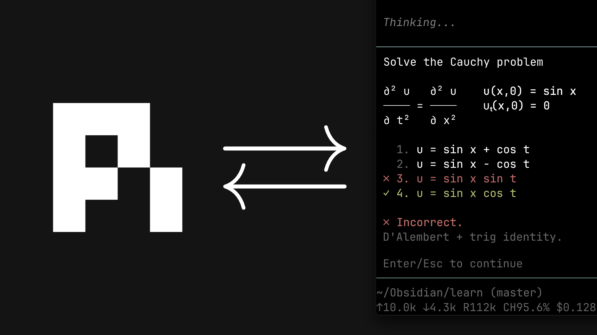

# learn

[](https://www.youtube.com/watch?v=kzcI5F4tGiU)

My AI learning system from this video: [How I Use AI to Learn Things](https://www.youtube.com/watch?v=kzcI5F4tGiU).

This is a personal system built as an OMP project configuration. It contains the teaching philosophy, a graded quiz, visual tools, and task-agent definitions.

## What's in it

- `.omp/skills/learn/` — the philosophy and the process
- `.omp/skills/visualize/` — adds a correct, minimal diagram to a lesson when an idea is clearer as a picture
- OMP's built-in `ask` tool — collects preferences, goals, and approval
- `.omp/extensions/quiz.ts` — graded questions with instant feedback (✓/✗, correct answer, explanation)
- `~/.omp/agent/extensions/md-log.ts` — links a Markdown file to the session
- `.omp/tools/visual-tools.ts` — OMP custom tools for visualization task agents
- `.omp/agents/` — `researcher`, `svg-maker`, and `mermaid-maker`

## Use

Install the local extension dependencies before starting OMP:

```bash
cd .omp && npm ci
```

Start OMP from this directory:

```bash
cd "/Users/christian/Documents/Vault/5 - AI/Learning"
omp
```

Then invoke:

```text
/skill:learn
```

## Requirements

- [Oh My Pi](https://github.com/can1357/oh-my-pi)
- OMP task agents for the researcher and visual makers
- Mermaid CLI and Chrome or Chromium for Mermaid rendering
- `rsvg-convert` or ImageMagick for SVG rendering

The visual system uses OMP task agents and OMP-native custom tools. It does not use Pi's `interactive-subagents` extension.

## Notes

You can run the system without task agents. The main session still does the teaching. You lose research delegation and generated visuals.

The teaching skill is written for one learner. Edit it to fit how you learn best.
